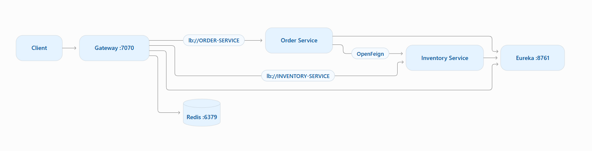

# Spring Cloud Gateway Demo

A focused Spring Cloud Gateway demo built around simplified and intentionally minimal `order-service` and `inventory-service` applications. 
The purpose of the project is to demonstrate gateway behavior: 

- explicit and programmatic routing
- service discovery and load-balanced routing
- route predicates
- built-in, default, global, and custom filters
- correlation ID propagation
- OpenFeign request interception
- Actuator visibility
- Redis-backed rate limiting

## Architecture



Eureka provides service discovery. The gateway uses explicit routes but resolves `lb://...` service IDs through discovery and Spring Cloud LoadBalancer. Redis stores the distributed token-bucket state used by `RequestRateLimiter`.

## Technology Stack

| Technology | Usage |
|---|---|
| Java 21 | Application language/runtime |
| Spring Boot | Application framework |
| Spring Cloud Gateway Server WebFlux | API gateway and reactive request processing |
| Spring WebFlux / Project Reactor | Non-blocking gateway execution model |
| Spring Cloud Netflix Eureka | Service registration and discovery |
| Spring Cloud LoadBalancer | Resolving and load balancing `lb://SERVICE-ID` routes |
| Spring Cloud OpenFeign | Declarative service-to-service HTTP calls |
| Redis / Spring Data Redis Reactive | Distributed state for gateway rate limiting |
| Spring Boot Actuator | Gateway route and runtime inspection |
| Maven | Build and dependency management |
| Docker / Docker Compose | Containerized local environment |

## What the demo covers

### Routing

- Explicit routes in `application.yml`
- Programmatic routes with `RouteLocatorBuilder`
- `Path`and `Method`predicates
- `lb://SERVICE-ID` routing through Eureka and Spring Cloud LoadBalancer
- Discovery locator intentionally disabled so the externally exposed routes remain explicit

Current public routes:

| Public route | Target | Definition | Main behavior                                                                                                            |
|---|---|---|--------------------------------------------------------------------------------------------------------------------------|
| `/orders/**` | `ORDER-SERVICE` | YAML | path rewrite, request header, response header, response-time filter, rate limiting, correlationId filter, logging filter |
| `/inventory/**` | `INVENTORY-SERVICE` | YAML | path rewrite, response header, rate limiting, correlationId filter, logging filter                                                      |
| `GET /check/**` | `INVENTORY-SERVICE` | Java `RouteLocator` | path rewrite and custom programmatic filters, correlationId filter, logging filter                                                       |

### Filters

The project shows several filter styles commonly used with Spring Cloud Gateway.

**Built-in route filters**

- `RewritePath`
- `AddRequestHeader`
- `AddResponseHeader`
- `RequestRateLimiter`

**Default filter**

YAML-defined routes receive:

```http
X-Gateway: spring-cloud-gateway
```

through `default-filters`.

**Global filters**

`CorrelationIdGlobalFilter` runs before `LoggingGlobalFilter`:

1. Read `X-Correlation-ID` when supplied by the caller.
2. Generate a UUID when it is missing.
3. Put the ID on the downstream request.
4. `LoggingGlobalFilter` then logs the request URI together with the same ID.

The explicit order values (`-10` and `-5`) make the correlation ID available before logging runs.

**Custom YAML-addressable filter**

`ResponseTimeGatewayFilterFactory` extends `AbstractGatewayFilterFactory` so it can be referenced from YAML as:

```yaml
- ResponseTime
```

It records the start time, waits until the response is about to be committed, and adds:

```http
X-Response-Time-Ms: <duration>
```

**Custom programmatic filters**

The Java-defined `/check/**` route demonstrates direct `GatewayFilter` usage. These filters are attached in the `RouteLocator` rather than referenced from YAML.

## Correlation ID propagation

Correlation ID handling shows both inbound gateway filtering and outbound service-to-service propagation.
The gateway is the first point in the request chain that creates or preserves `X-Correlation-ID`.

```text
Client
  -> Gateway
       X-Correlation-ID: abc
  -> Order Service
       same correlation ID
  -> Inventory Service
       same correlation ID
```

The downstream services use the correlation ID for request tracing/logging. When Order calls Inventory through OpenFeign, a Feign `RequestInterceptor` propagates the same ID to the new outgoing HTTP request.

A separate client-specific Feign configuration can add headers only to one Feign client. In this demo, `X-Calling-Service` is added to calls made through the Inventory Feign client. Another Feign client would not receive that header unless it explicitly used the same configuration.

This distinction is intentional:

- `X-Correlation-ID` is cross-service request context and should propagate through the request chain.
- `X-Calling-Service` is client-specific metadata and is scoped to the Inventory call.

## Redis-backed rate limiting

`/orders/**` and `/inventory/**` use Spring Cloud Gateway's Redis `RequestRateLimiter`.

The key is resolved from:

```http
X-Client-Id: <client-identifier>
```

Current configuration:

```yaml
redis-rate-limiter.replenishRate: 10
redis-rate-limiter.burstCapacity: 20
redis-rate-limiter.requestedTokens: 1
```

Meaning:

- 10 tokens are replenished per second.
- The bucket can hold at most 20 tokens.
- Each request consumes 1 token.
- A request over the available quota is rejected with `429 Too Many Requests`.
- A request without a resolvable `X-Client-Id` is denied by the empty-key behavior.

Successful requests expose rate-limit information such as:

```http
X-RateLimit-Remaining: 19
X-RateLimit-Requested-Tokens: 1
X-RateLimit-Burst-Capacity: 20
X-RateLimit-Replenish-Rate: 10
```

Redis is used rather than an in-memory counter so multiple gateway instances can share the same rate-limit state.

## Actuator

The gateway Actuator endpoint is exposed read-only for inspection.

Useful endpoints:

```text
GET /actuator/health
GET /actuator/gateway/routes
GET /actuator/gateway/globalfilters
GET /actuator/gateway/routefilters
GET /actuator/metrics
```

## Running the demo

The configuration supports environment overrides for the gateway port, Eureka URL, Redis host/port, instance ID, and hostname.

```bash
docker compose up --build
```

Default infrastructure endpoints:

```text
Gateway: http://localhost:7070
Eureka:  http://localhost:8761
Redis:   localhost:6379
```

## Testing

The [`gateway-demo.http`](./gateway-demo.http) file provides a small manual
smoke-test collection for exercising the gateway.

The file covers:

- Order and Inventory routing through the gateway
- programmatic `/check/**` routing
- generated and caller-supplied correlation IDs
- missing `X-Client-Id`
- Redis rate-limit headers
- repeated requests with the same client ID for rate-limit testing

## Containerization

The services use multi-stage/layered Docker builds to reduce unnecessary
runtime image contents and improve dependency-layer reuse during rebuilds